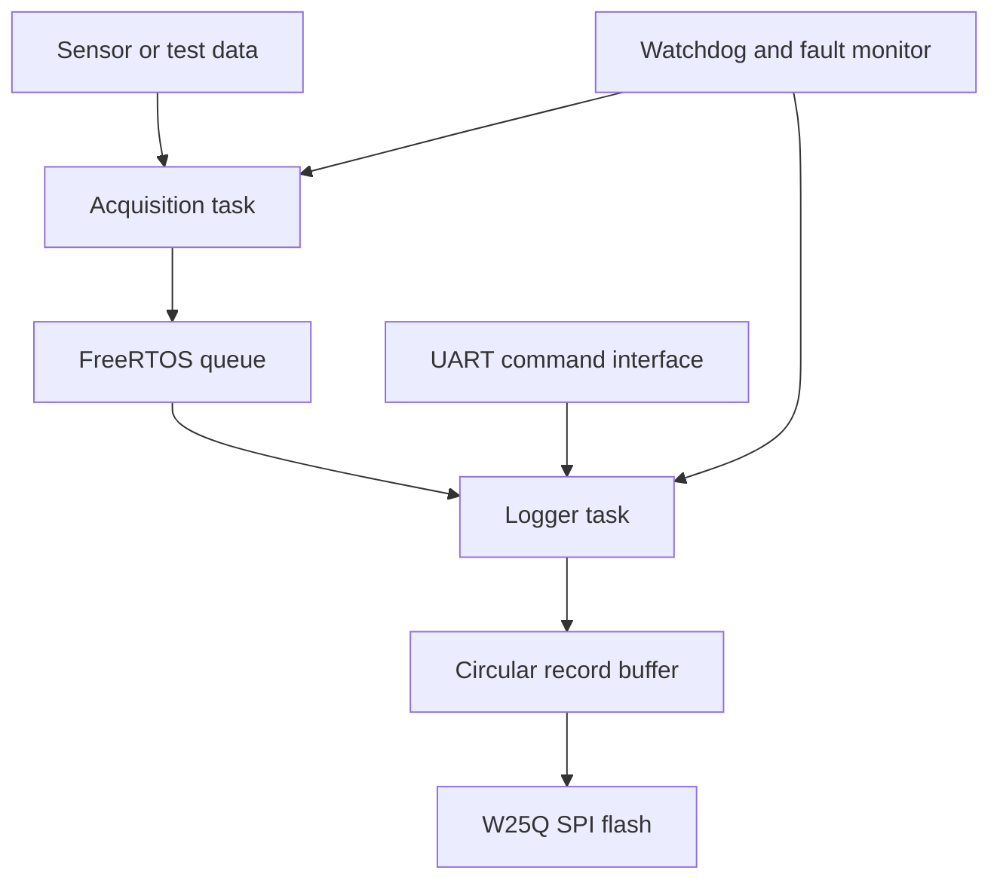

# STM32 Bare-Metal Driver and FreeRTOS Data Logger

> **Status: Repository scaffold — implementation in progress.**
> No driver, RTOS feature, or hardware result is presented as complete until its source code and test evidence are committed.

This repository is the development workspace for a register-level embedded firmware project targeting the **STM32F446RE (Arm Cortex-M4)**. The planned system combines custom peripheral drivers, FreeRTOS-based task coordination, and circular-buffer logging to an external **W25Q-series SPI flash** device.

## Project objective

Build the firmware incrementally while learning and demonstrating:

- register-level STM32 peripheral configuration;
- interrupt-driven firmware design;
- safe communication between FreeRTOS tasks and interrupts;
- reliable buffered storage in external SPI flash;
- watchdog recovery, fault handling, and testable driver interfaces.

## Planned feature matrix

| Area | Planned capability | Current status |
|---|---|---|
| MCU bring-up | Clock, startup, linker, GPIO output | Not started |
| UART | Polling, interrupt-driven TX/RX, circular RX buffer | Not started |
| SPI | Blocking transfer followed by interrupt/DMA exploration | Not started |
| I2C | Master transmit/receive and timeout handling | Not started |
| CAN | Basic configuration, transmit, receive, and filtering | Not started |
| ADC | Single-channel sampling and periodic acquisition | Not started |
| Timer/PWM | Periodic timer and PWM output | Not started |
| Interrupts | NVIC configuration and ISR-safe data handling | Not started |
| External flash | W25Q identification, erase, page program, and read | Not started |
| FreeRTOS | Tasks, queues, semaphores, notifications, and software timers | Not started |
| Data logger | Timestamped records, circular storage, and recovery | Not started |
| Reliability | Watchdog, error codes, boundary checks, and fault tests | Not started |

## Planned architecture



## Repository structure

```text
firmware/
  Core/          Application entry point and board configuration
  Drivers/       Register-level peripheral driver interfaces and sources
  FreeRTOS/      RTOS configuration and task modules
docs/            Architecture notes, roadmap, and design decisions
tests/
  host/          Host-side unit tests for hardware-independent logic
  hardware/      On-target test procedures and captured evidence
```

## Target hardware and tools

- STM32F446RE target; the exact development board and pin mapping will be documented before implementation.
- W25Q-series SPI NOR flash; the exact part number and capacity are still to be selected.
- Arm GNU Toolchain or STM32CubeIDE toolchain.
- ST-LINK debugger and GDB/OpenOCD or the debugger supplied with STM32CubeIDE.
- Serial terminal and, where available, a logic analyser or oscilloscope.

No board pins, clock values, flash commands, or register settings will be added without checking the exact board schematic, STM32F446 reference manual, device datasheet, and W25Q datasheet.

## Development approach

1. Establish a reproducible build and debug session.
2. Complete minimal clock and GPIO bring-up.
3. Add one peripheral driver at a time with a small hardware test.
4. Add reusable timeout, error, and circular-buffer modules.
5. Validate W25Q read/program/erase operations.
6. Introduce FreeRTOS only after the underlying drivers work without it.
7. Build the queued data logger and add recovery/fault tests.

See [ROADMAP.md](docs/ROADMAP.md) for milestone acceptance criteria and [PROJECT_STATUS.md](PROJECT_STATUS.md) for the current verified state.

## Evidence policy

A feature may be marked complete only when the repository contains:

- the relevant source code;
- build instructions and a successful build record;
- a repeatable test procedure;
- observed output, trace, or hardware evidence;
- known limitations.

This prevents plans, generated files, and untested code from being presented as completed engineering work.
